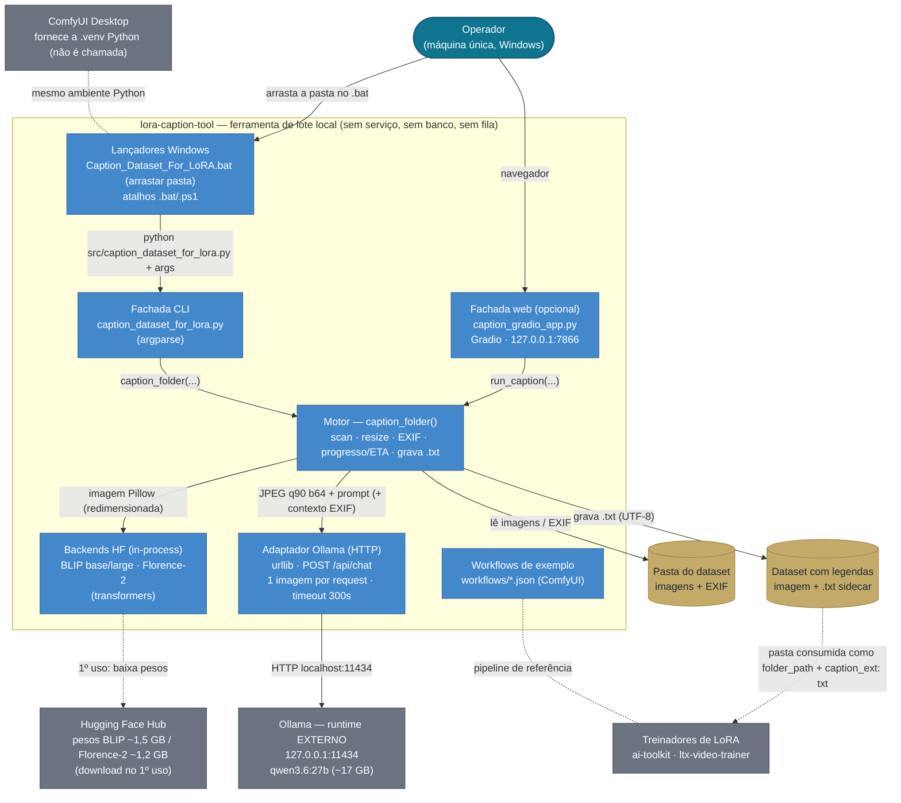
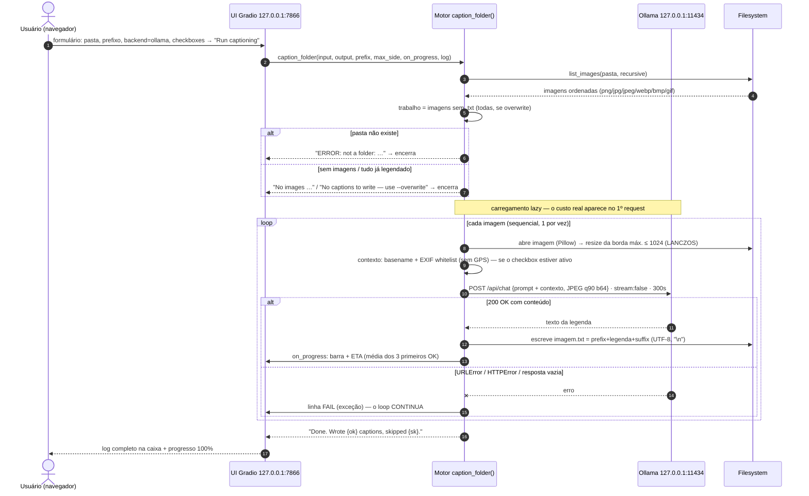
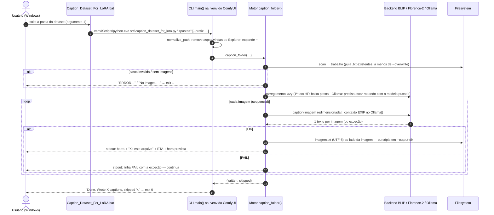

# lora-caption-tool — Discovery de Documentação · Unidade III (Diagrams as Code)

Este repositório concentra a **fase de discovery de documentação** de um sistema que o
aluno realmente usa: o
[`lora-caption-tool`](https://github.com/kruszielski/lora-caption-tool) — ferramenta de
lote **local** que gera **legendas densas (`.txt`)** para datasets de treino de **LoRA**,
usando modelos de visão (**BLIP**, **Florence-2** ou **Ollama**).

Na esteira da abordagem da unidade, **tudo aqui é código**: a descrição em linguagem
natural, os diagramas **Mermaid** (gerados com **GenAI** e depois **verificados linha a
linha contra o código-fonte**) e o registro das decisões sobre o que o modelo produziu.
O objetivo é que este repositório sirva, no futuro, de **contexto para agentes de
desenvolvimento** implementarem o sistema com aderência à arquitetura documentada.

> **Nada do sistema é reimplementado aqui.** O repositório concentra o discovery: a
> documentação e os diagramas são a entrega; o código continua no
> [repositório upstream](https://github.com/kruszielski/lora-caption-tool).

---

## O caso

`lora-caption-tool` resolve uma dor real do fluxo de treino de LoRA de personagem/estilo:
escrever uma legenda por imagem **à mão** é lento e inconsistente — e legenda
inconsistente vira ruído para o treinador. A ferramenta percorre uma pasta de imagens,
passa cada uma por um modelo de visão (local, com EXIF e nome de arquivo como contexto) e
grava `imagem.txt` ao lado — o formato exato que `ai-toolkit`, `ltx-video-trainer` e
ComfyUI esperam. Ela tem **duas fachadas** (CLI com `.bat` de drag & drop, e UI Gradio
local) sobre **um único motor** (`caption_folder`).

---

## Artefatos

| # | Artefato | Conteúdo |
|---|---|---|
| [01](docs/01-descricao-sistema.md) | **Descrição do sistema** (linguagem natural) | Escopo (dentro/fora), nível da visão, fronteiras e responsabilidades, integrações, restrições e **10 lacunas** registradas |
| [02](docs/02-ia-diagramas.md) | **Uso de GenAI** | O que o modelo inferiu corretamente, o que foi ajustado, o que foi descartado — com justificativa |
| [03](docs/03-contractos-para-agentes.md) | **Contratos para agentes** | As ~30 decisões que um agente inventaria se não estivessem travadas; 5 ficam `ABERTO` de propósito |
| [diagrams/](diagrams/) | **Fontes Mermaid** | `container-view.mmd` (estrutural), `sequence-gradio-ollama.mmd` e `sequence-cli-batch.mmd` (comportamentais) + PNGs renderizados |
| [AGENTS.md](AGENTS.md) | **Contexto para agentes de desenvolvimento** | O que o sistema é, o que **não** fazer, e a regra “número sem marcador é lacuna” |
| [POSTAGEM-FORUM.md](POSTAGEM-FORUM.md) | **Postagem do fórum** | texto pronto (versões completa e curta) |

---

## 1 · Os diagramas — renderizados

Ambos os tipos pedidos pela atividade estão **neste README, renderizados** (o GitHub
renderiza Mermaid nativamente) e versionados em [`diagrams/`](diagrams/): o bloco abaixo
**é** o arquivo `.mmd` — uma única fonte de verdade.

Eles foram gerados por um assistente de GenAI **com acesso ao código-fonte** da
ferramenta e depois verificados contra `src/` — o registro completo de correções está em
[docs/02](docs/02-ia-diagramas.md).

### 1.1 Estrutural — visão de containers (inspirada no C4)



**Como ler:** duas fachadas sobre **um** motor; duas *classes* de backend (in-process ×
HTTP externo); os **arquivos são o único estado** (não há banco); os sistemas externos
(Ollama, HF Hub, ComfyUI, treinadores) **não pertencem** ao sistema — e o ComfyUI,
notadamente, *fornece ambiente* em vez de receber dados
([M-01/M-02](docs/02-ia-diagramas.md)).

### 1.2 Comportamental — jornada crítica: legendagem em lote pela UI Gradio (Ollama)



**Como ler:** a jornada foi escolhida pela pergunta do [docs/02](docs/02-ia-diagramas.md)
— *qual, se quebrar, torna a ferramenta inútil?* É a única que ela existe para fazer.
Dois detalhes do código aparecem como **decisões de design** no diagrama: o **carregamento
lazy** do modelo (M-06) e o **erro isolado por arquivo** — a execução é *tolerante*, não
atômica (M-05).

### 1.3 Comportamental — jornada de drag & drop no Windows (CLI)



**Como ler:** mostra o que a versão Gradio esconde — a **camada de conveniência**
(`.bat` → `.venv` do ComfyUI → `normalize_path` contra aspas do Explorer) e os
**exit codes**. O loop é idêntico ao 1.2: mesma fachada-codificada, dois invokers.

---

## 2 · Descrição do sistema (síntese)

O inteiro está em [docs/01](docs/01-descricao-sistema.md); aqui, o essencial:

- **O que é:** ferramenta de lote **local** que percorre uma pasta de imagens e grava,
  para cada uma, uma legenda densa `.txt` sidecar — o formato exato que os treinadores de
  LoRA consomem. Ela **não treina**: para quando o dataset está pronto.
- **Nível da visão:** não é serviço — uma máquina, um operador, uma execução por vez,
  arquivos entrando e arquivos saindo. Duas fachadas (CLI `.bat` de drag & drop; UI
  Gradio em `127.0.0.1:7866`) sobre **um** motor (`caption_folder`).
- **Dentro do escopo:** 3 backends de visão (BLIP / Florence-2 in-process; Ollama via
  HTTP); prompt denso editável; contexto de arquivo/EXIF com whitelist (GPS sempre fora,
  opt-out); gatilho via prefix/suffix; resize; progresso com ETA; saída ao lado ou em
  pasta separada; conveniências Windows; workflows ComfyUI de referência.
- **Fora do escopo:** treino de LoRA; curadoria/revisão de legendas; nuem; empacotamento.
- **Integrações:** Ollama (runtime externo, 127.0.0.1:11434), Hugging Face Hub (pesos no
  1º uso), ComfyUI Desktop (ambiente Python, não chamada), filesystem (o dataset) e,
  indiretamente, os treinadores (`ai-toolkit`, `ltx-video-trainer`).
- **Restrições:** Windows-first; Pillow é a única dependência dura; GPU necessária
  (qwen3.6:27b ≈ 17 GB de VRAM); sem paralelismo; local-first por princípio.
- **Lacunas:** 10 registradas com impacto (`LG-01..10`), de “sem testes automatizados” a
  “rótulo da UI contradiz o código no resize”.

---

## 3 · Decisões e ajustes sobre o que a GenAI gerou

| | |
|---|---|
| Inferências **aprovadas** | 6 |
| Sugestões **modificadas** | 6 |
| Sugestões **descartadas** | 5 |

O detalhamento item a item está em [docs/02](docs/02-ia-diagramas.md); os destaques:

- **Acertos:** as 3 classes de backend nas suas duas naturezas de execução; 2 fachadas /
  1 motor (sem duplicar o fluxo); a semântica do ETA pelos **3 primeiros com sucesso**; a
  fronteira de privacidade do EXIF; a escolha da jornada crítica; a saída como contrato
  com os treinadores.
- **Invenções cortadas:** API REST + tabela `captions` + fila de jobs + Docker +
  autenticação + fallback em nuvem — a arquitetura canônica de “ferramenta web”
  transplantada para uma **ferramenta de lote** que não tem nenhum desses.
- **O caso que o modelo não pegou (só o código pega):** o rótulo da UI “Max side …
  **HF only**” contradiz o loop, que redimensiona **todos** os backends. O diagrama
  documenta o **comportamento do código**; o rótulo ficou registrado como lacuna real do
  sistema original (`LG-05`).

---

## 4 · Para agentes de desenvolvimento (o “a mais” da documentação)

A atividade pediu pensar neste repositório como **contexto futuro para agentes**. A
resposta está em [docs/03](docs/03-contractos-para-agentes.md): os documentos de
descritiva dão a *forma*, mas forma não é contrato — o doc 03 **trava com valor** as
~30 decisões que um agente inventaria (parâmetros, formato do `.txt`, whitelist de EXIF,
contratos dos backends, progresso/exit codes, restrições não-negociáveis,
**não-objetivos explícitos**) e deixa **5 decisões `ABERTO`** de propósito, com a regra:
agente **pergunta**, não chuta. O [AGENTS.md](AGENTS.md) é a porta de entrada disso.

---

## 5 · Como (re)renderizar os diagramas

Os blocos acima renderizam nativamente no GitHub a partir do **mesmo** conteúdo dos
`.mmd` de [`diagrams/`](diagrams/). Para PNGs fora do GitHub:

```bash
npx -y @mermaid-js/mermaid-cli -i diagrams/container-view.mmd -o diagrams/rendered/container-view.png
npx -y @mermaid-js/mermaid-cli -i diagrams/sequence-gradio-ollama.mmd -o diagrams/rendered/sequence-gradio-ollama.png
npx -y @mermaid-js/mermaid-cli -i diagrams/sequence-cli-batch.mmd -o diagrams/rendered/sequence-cli-batch.png
```

Os PNGs em [`diagrams/rendered/`](diagrams/rendered/) foram gerados com `mermaid-cli`
para uso offline; se divergirem dos blocos, **o bloco do README (e o `.mmd`) vencem**.

---

## Sugestão de leitura

1. [01 — Descrição do sistema](docs/01-descricao-sistema.md) — para formar impressão própria
2. [03 — Contratos para agentes](docs/03-contractos-para-agentes.md) — responde a pergunta da unidade
3. [02 — Uso de GenAI](docs/02-ia-diagramas.md) — o que o modelo acertou, corrigiu e inventou
4. [AGENTS.md](AGENTS.md) — como este repositório deve ser consumido por um agente

